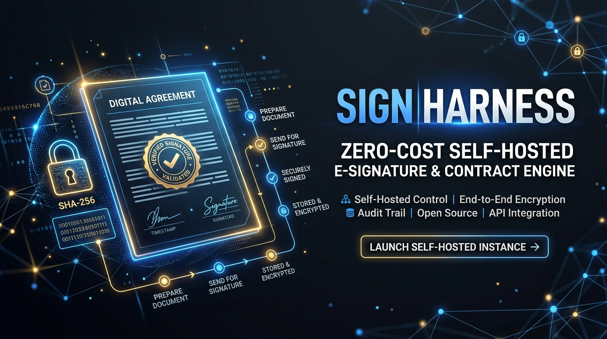

# Sign Harness ✍️


> **クラウドサイン・DocuSignの「月額固定費＋1通200円課金」をゼロにする、セルフホスト型・AIネイティブ電子契約＆暗号監査エンジン**  
> *Cloudflare Workers × Web Crypto API (SHA-256 / HMAC Seal) × D1 Database × MCP (Model Context Protocol)*

---

## 💡 なぜ「Sign Harness」なのか？

フリーランス、中小企業、スタートアップ、士業において、秘密保持契約（NDA）や業務委託契約を結ぶたびに発生する**「電子契約SaaSの基本料（月1万〜）＋送信ごと課金（1通200円）」**は、契約数が増えるほどボディブローのように効いてきます。

| サービス | 月額基本料 | 送信従量課金 | 課題・不満 |
| :--- | :--- | :--- | :--- |
| **大手電子契約SaaS** | 月額 10,000円〜 | 1通 100〜220円 | 月に数通しか使わない月も1万円以上の固定費が発生 |
| **海外製E-Signツール** | 月額 $25〜$65+ | エンベロープ上限あり | 上限を超えると高額プランへのアップグレードが必須 |
| **🔥 Sign Harness** | **実質 ¥0** | **¥0（無制限）** | **Web Crypto APIによるSHA-256改ざん防止ハッシュ＋監査証跡ログを自前D1に完全保存。** |

---

## 🌟 主な機能

1. **Web Crypto API による暗号学的改ざん検知（SHA-256 ＆ HMAC-SHA256 署名シール）**
   - 契約書作成時に条文テキストの `SHA-256` ダイジェストを計算・記録。
   - 相手方が署名を実行した瞬間、`契約ID + 文書SHA-256 + 署名者メールアドレス + ISOタイムスタンプ + 接続元IP` を結合した暗号署名シール（Signature Seal）を発行。1文字でも契約文面が書き換えられれば再検証で即座に検知可能です。
2. **完全な監査証跡ログ（Immutable Audit Trail）**
   - 作成・閲覧・署名・検証のすべてのイベントについて、日時・メールアドレス・IPアドレス・User-AgentをCloudflare D1に記録。
3. **AIエージェントネイティブ（MCP対応）**
   - Claude Code や Cursor から自然言語で契約書作成・ステータス確認・改ざん検証が可能：
   - 例: `「株式会社〇〇向けの秘密保持契約書（NDA）を作成して署名URLを発行して」`
   - 例: `「現在署名待ち（pending_signature）の契約一覧を出して」`
   - 例: `「契約ID cnt_nda_01 のSHA-256ハッシュと署名シールの真正性を検証して」`

---

## 🚀 クイックスタート

```bash
npm install
npx wrangler d1 create sign-db
# wrangler.toml に database_id を設定後:
npm run d1:remote
npm run deploy
```

### ローカル開発・デモ確認
```bash
npm run dev
# http://localhost:8789 で電子契約＆暗号検証ポータルが起動します
```
